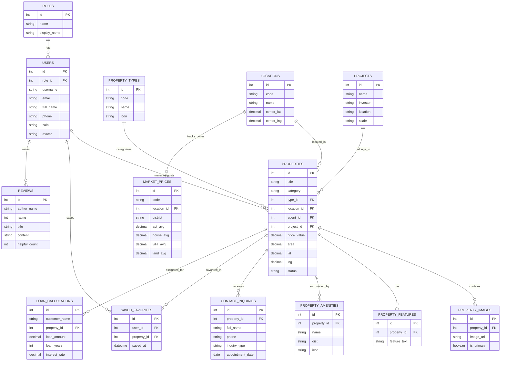

# 🗄️ BÁO CÁO THIẾT KẾ & TÀI LIỆU CƠ SỞ DỮ LIỆU
## ĐỒ ÁN MÔN HỌC: PHÁT TRIỂN ỨNG DỤNG WEB (WEB APPLICATION DEVELOPMENT)
### DỰ ÁN: BĐS VIỆT HUB - HỆ THỐNG CỔNG THÔNG TIN BẤT ĐỘNG SẢN & BẢN ĐỒ SỐ TOÀN DIỆN (NHÓM 15)

---

## 📌 I. TỔNG QUAN HỆ THỐNG CƠ SỞ DỮ LIỆU

Cơ sở dữ liệu của dự án **BĐS Việt Hub (Nhóm 15)** được thiết kế theo chuẩn cơ sở dữ liệu quan hệ (RDBMS) bậc cao, tối ưu hóa cho hệ thống web bất động sản thời gian thực có tích hợp bản đồ số vệ tinh (Leaflet / GIS coordinates).

### 1. Thông số kỹ thuật
- **Tên cơ sở dữ liệu:** `nhom15_batdongsan_db`
- **Hệ quản trị CSDL hỗ trợ:** MySQL 8.0+, MariaDB 10.4+, SQLite 3
- **Bảng mã ký tự (Charset):** `utf8mb4` (Hỗ trợ 100% tiếng Việt có dấu đầy đủ và các biểu tượng icon/emoji)
- **Đối chiếu (Collation):** `utf8mb4_unicode_ci` (Tìm kiếm không phân biệt hoa thường và dấu tiếng Việt chuẩn xác)
- **Tập tin CSDL đã khởi tạo:**
  1. [`database.sql`](file:///E:/Nhom-15/database.sql): Tập tin kịch bản DDL + DML đầy đủ cho MySQL / phpMyAdmin / XAMPP / Laragon.
  2. [`database.sqlite`](file:///E:/Nhom-15/database.sqlite): Cơ sở dữ liệu SQLite nhúng sẵn sàng chạy không cần cài đặt máy chủ MySQL.
  3. [`database.json`](file:///E:/Nhom-15/database.json): Dữ liệu cấu trúc JSON phục vụ Mock API / RESTful API / Frontend.

---

## 🗺️ II. SƠ ĐỒ THỰC THỂ QUAN HỆ (ERD - ENTITY RELATIONSHIP DIAGRAM)



---

## 📋 III. TỪ ĐIỂN DỮ LIỆU CHI TIẾT (DATA DICTIONARY)

Hệ thống bao gồm **14 bảng dữ liệu cốt lõi**, 2 **Khung nhìn (Views)** và 2 **Thủ tục lưu trữ (Stored Procedures)**:

### 1. Bảng `roles` (Phân quyền người dùng)
| Tên cột | Kiểu dữ liệu | Khóa | Cho phép NULL | Mô tả |
| :--- | :--- | :---: | :---: | :--- |
| `id` | `INT AUTO_INCREMENT` | **PK** | KHÔNG | Khóa chính |
| `name` | `VARCHAR(50)` | UNIQUE | KHÔNG | Mã vai trò: `admin`, `agent`, `customer` |
| `display_name` | `VARCHAR(100)` | | KHÔNG | Tên hiển thị tiếng Việt |
| `description` | `TEXT` | | CÓ | Mô tả quyền hạn |

### 2. Bảng `users` (Tài khoản người dùng, Môi giới & Quản trị)
| Tên cột | Kiểu dữ liệu | Khóa | Cho phép NULL | Mô tả |
| :--- | :--- | :---: | :---: | :--- |
| `id` | `INT AUTO_INCREMENT` | **PK** | KHÔNG | Khóa chính |
| `role_id` | `INT` | **FK** | KHÔNG | Tham chiếu tới `roles(id)` |
| `username` | `VARCHAR(80)` | UNIQUE | KHÔNG | Tên đăng nhập |
| `email` | `VARCHAR(150)` | UNIQUE | KHÔNG | Email liên hệ |
| `password_hash`| `VARCHAR(255)` | | KHÔNG | Mật khẩu băm an toàn Bcrypt |
| `full_name` | `VARCHAR(150)` | | KHÔNG | Họ và tên |
| `phone` | `VARCHAR(25)` | | KHÔNG | Số điện thoại Zalo |
| `zalo` | `VARCHAR(255)` | | CÓ | Đường dẫn Zalo chat |
| `avatar` | `VARCHAR(500)` | | CÓ | URL hình ảnh đại diện |
| `title` | `VARCHAR(150)` | | CÓ | Danh xưng chuyên viên |
| `company` | `VARCHAR(150)` | | CÓ | Công ty / Chi nhánh |
| `is_verified` | `TINYINT(1)` | | KHÔNG | Trạng thái tích xanh xác minh (1/0) |

### 3. Bảng `property_types` (Danh mục Loại hình BĐS)
| Tên cột | Kiểu dữ liệu | Khóa | Cho phép NULL | Mô tả |
| :--- | :--- | :---: | :---: | :--- |
| `id` | `INT AUTO_INCREMENT` | **PK** | KHÔNG | Khóa chính |
| `code` | `VARCHAR(50)` | UNIQUE | KHÔNG | Mã loại hình (`apartment`, `house`, `villa`, `land`) |
| `name` | `VARCHAR(100)` | | KHÔNG | Tên loại hình hiển thị |
| `icon` | `VARCHAR(50)` | | KHÔNG | Mã icon FontAwesome (`fa-building`, `fa-house`...) |

### 4. Bảng `locations` (Danh mục Tỉnh / Thành phố & Tọa độ tâm bản đồ)
| Tên cột | Kiểu dữ liệu | Khóa | Cho phép NULL | Mô tả |
| :--- | :--- | :---: | :---: | :--- |
| `id` | `INT AUTO_INCREMENT` | **PK** | KHÔNG | Khóa chính |
| `code` | `VARCHAR(50)` | UNIQUE | KHÔNG | Mã thành phố (`cantho`, `hcm`, `hn`, `danang`, `binhduong`, `dongnai`) |
| `name` | `VARCHAR(100)` | | KHÔNG | Tên tỉnh/thành |
| `region` | `VARCHAR(50)` | | KHÔNG | Khu vực: Miền Nam, Miền Bắc, Miền Trung |
| `center_lat` | `DECIMAL(10, 7)` | | KHÔNG | Vĩ độ tâm bản đồ Leaflet |
| `center_lng` | `DECIMAL(10, 7)` | | KHÔNG | Kinh độ tâm bản đồ Leaflet |
| `default_zoom` | `INT` | | KHÔNG | Zoom mặc định |

### 5. Bảng `projects` (Danh mục Đại đô thị & Dự án quy mô)
| Tên cột | Kiểu dữ liệu | Khóa | Cho phép NULL | Mô tả |
| :--- | :--- | :---: | :---: | :--- |
| `id` | `INT AUTO_INCREMENT` | **PK** | KHÔNG | Khóa chính (101, 102, 103, 104...) |
| `name` | `VARCHAR(255)` | | KHÔNG | Tên dự án (Vinhomes Grand Park, Masteri Centre Point...) |
| `investor` | `VARCHAR(150)` | | KHÔNG | Chủ đầu tư (Vingroup, Masterise Homes, Daewoo E&C...) |
| `location` | `VARCHAR(255)` | | KHÔNG | Vị trí địa chỉ dự án |
| `scale` | `VARCHAR(100)` | | KHÔNG | Quy mô (271 hecta, 10 tháp...) |
| `status` | `VARCHAR(100)` | | KHÔNG | Tiến độ thi công / mở bán |
| `price_range` | `VARCHAR(100)` | | KHÔNG | Khoảng giá |
| `image_url` | `VARCHAR(500)` | | KHÔNG | Ảnh đại diện dự án |

### 6. Bảng `properties` (Tin đăng Bất Động Sản chính)
| Tên cột | Kiểu dữ liệu | Khóa | Cho phép NULL | Mô tả |
| :--- | :--- | :---: | :---: | :--- |
| `id` | `INT AUTO_INCREMENT` | **PK** | KHÔNG | Khóa chính |
| `title` | `VARCHAR(255)` | | KHÔNG | Tiêu đề tin đăng |
| `category` | `ENUM('sale', 'rent')` | | KHÔNG | `sale`: Mua bán, `rent`: Cho thuê |
| `type_id` | `INT` | **FK** | KHÔNG | Khóa ngoại tới `property_types(id)` |
| `location_id` | `INT` | **FK** | KHÔNG | Khóa ngoại tới `locations(id)` |
| `district` | `VARCHAR(100)` | | KHÔNG | Quận / Huyện |
| `address` | `VARCHAR(255)` | | KHÔNG | Địa chỉ chi tiết |
| `lat` | `DECIMAL(10, 7)` | | KHÔNG | Tọa độ GPS Vĩ độ (Latitude) phục vụ ghim bản đồ |
| `lng` | `DECIMAL(10, 7)` | | KHÔNG | Tọa độ GPS Kinh độ (Longitude) |
| `price_display`| `VARCHAR(50)` | | KHÔNG | Giá hiển thị (12.8 Tỷ, 3.2 Tỷ, 65 tr/th...) |
| `price_value` | `DECIMAL(15, 2)` | | KHÔNG | Giá quy đổi Triệu VNĐ (12800, 3200) để lọc và sắp xếp |
| `unit_price` | `VARCHAR(50)` | | CÓ | Đơn giá m2 |
| `area` | `DECIMAL(10, 2)` | | KHÔNG | Diện tích (m²) |
| `bedrooms` | `INT` | | KHÔNG | Số phòng ngủ |
| `bathrooms` | `INT` | | KHÔNG | Số phòng vệ sinh |
| `badge` | `VARCHAR(50)` | | CÓ | Huy hiệu (VIP HOT, CHÍNH CHỦ, GOOGLE MAPS HOT) |
| `legal` | `VARCHAR(150)` | | CÓ | Tình trạng pháp lý (Sổ hồng, HĐMB) |
| `furniture` | `VARCHAR(150)` | | CÓ | Tình trạng nội thất |
| `description` | `MEDIUMTEXT` | | KHÔNG | Bài viết mô tả chi tiết |
| `agent_id` | `INT` | **FK** | KHÔNG | Khóa ngoại tới `users(id)` phụ trách |
| `project_id` | `INT` | **FK** | CÓ | Khóa ngoại tới `projects(id)` (nếu thuộc dự án) |
| `views_count` | `INT` | | KHÔNG | Lượt xem tin |

### 7. Các bảng phụ trợ
- `property_images`: Thư viện nhiều hình ảnh thực tế cho mỗi BĐS (1:N, hỗ trợ cascade delete).
- `property_features`: Danh sách các tiện ích & đặc điểm nổi bật.
- `property_amenities`: Tiện ích ngoại khu lân cận kèm khoảng cách thực tế (200m, 500m...) và icon.
- `market_prices`: Dữ liệu biến động giá theo từng quận huyện tại 5 tỉnh/thành phố năm 2026.
- `reviews`: Nhận xét, số sao đánh giá của khách hàng và câu trả lời của ban quản trị.
- `contact_inquiries`: Đăng ký xem nhà trực tiếp và tư vấn pháp lý / gói vay.
- `saved_favorites`: Danh sách tin yêu thích được người dùng lưu lại.
- `loan_calculations`: Bảng lưu dự toán tài chính mua nhà của khách hàng.

---

## ⚡ IV. KHUNG NHÌN (VIEWS) & THỦ TỤC LƯU TRỮ (STORED PROCEDURES)

### 1. View `v_properties_detailed`
Tự động kết hợp dữ liệu bảng `properties` với `property_types`, `locations`, `users` (Môi giới), `projects` và lấy trực tiếp `primary_image` cùng `total_images`.
```sql
SELECT * FROM v_properties_detailed WHERE city_code = 'cantho';
```

### 2. View `v_market_by_city`
Thống kê giá nhà đất bình quân theo từng thành phố và tỷ lệ tăng trưởng YoY.
```sql
SELECT * FROM v_market_by_city;
```

### 3. Thủ tục lưu trữ `sp_search_properties`
Hỗ trợ tìm kiếm đa tiêu chí với các tham số: Từ khóa, Loại hình, Tỉnh thành, Khoảng giá, Diện tích.
```sql
-- Tìm các căn hộ tại TP. Hồ Chí Minh giá từ 2 đến 10 tỷ
CALL sp_search_properties('', 'sale', 'hcm', 'apartment', 2000, 10000, NULL, NULL);
```

### 4. Thủ tục lưu trữ `sp_get_property_detail`
Lấy chi tiết một bất động sản và tự động tăng số lượt xem lên 1.
```sql
CALL sp_get_property_detail(10);
```

---

## 🚀 V. HƯỚNG DẪN IMPORT VÀO CƠ SỞ DỮ LIỆU

### Cách 1: Sử dụng phpMyAdmin / XAMPP / Laragon (Khuyên dùng)
1. Khởi động **Apache** và **MySQL** trong bảng điều khiển XAMPP / Laragon.
2. Mở trình duyệt web và truy cập: `http://localhost/phpmyadmin/`.
3. Nhấp vào tab **Nhập (Import)** ở thanh trên cùng.
4. Chọn tệp tin [`database.sql`](file:///E:/Nhom-15/database.sql) từ thư mục dự án.
5. Nhấp nút **Thực hiện (Go)**. File sẽ tự động tạo database `nhom15_batdongsan_db` cùng toàn bộ bảng và dữ liệu.

### Cách 2: Sử dụng Dòng lệnh MySQL (Command Line)
```bash
mysql -u root -p < "E:\Nhom-15\database.sql"
```

### Cách 3: Sử dụng SQLite (Không cần cài server)
Mở tệp [`database.sqlite`](file:///E:/Nhom-15/database.sqlite) bằng **DB Browser for SQLite** hoặc **VS Code SQLite Viewer**.

---

## 💡 VI. MÃ KẾT NỐI MẪU (BACKEND CONNECTION SNIPPETS)

### 1. Kết nối với PHP (PDO)
```php
<?php
// db.php
$host = '127.0.0.1';
$db   = 'nhom15_batdongsan_db';
$user = 'root';
$pass = '';
$charset = 'utf8mb4';

$dsn = "mysql:host=$host;dbname=$db;charset=$charset";
$options = [
    PDO::ATTR_ERRMODE            => PDO::ERRMODE_EXCEPTION,
    PDO::ATTR_DEFAULT_FETCH_MODE => PDO::FETCH_ASSOC,
    PDO::ATTR_EMULATE_PREPARES   => false,
];

try {
     $pdo = new PDO($dsn, $user, $pass, $options);
} catch (\PDOException $e) {
     throw new \PDOException($e->getMessage(), (int)$e->getCode());
}
?>
```

### 2. Kết nối với Node.js (MySQL2 / Promise)
```javascript
// db.js
const mysql = require('mysql2/promise');

const pool = mysql.createPool({
  host: 'localhost',
  user: 'root',
  password: '',
  database: 'nhom15_batdongsan_db',
  waitForConnections: true,
  connectionLimit: 10,
  queueLimit: 0
});

module.exports = pool;
```

---
*Bản quyền tài liệu thuộc về Nhóm 15 - Môn Phát triển Ứng dụng Web.*
